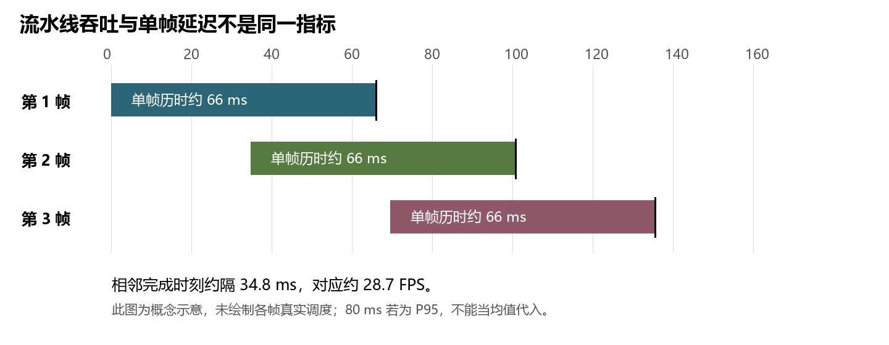
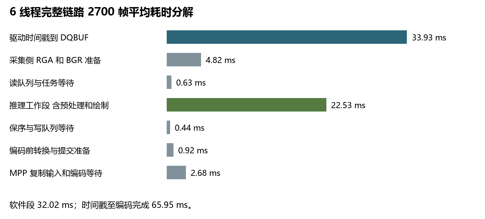

# RK3588 摄像头帧率和延迟实测说明

实验时间为 2026 年 10 月 25 至 26 日。本文在 10 月 27 日重写说明，没有补做新实验，也没有修改原始数据。

## 1 为什么没有达到 30 FPS

先说目前查到哪一步：只采集摄像头画面时，可以接近 30 FPS；把检测和编码都跑起来以后，程序取到的相机帧就已经不够每秒 30 张，最后输出也只有约 28.8 FPS。记录中的帧号会跳号，说明有些源帧没有出现在程序收到的图像里。

这能解释帧率为什么少了，但还没有解释清楚为什么会缺帧。上次实验没有把原因查到具体的代码或驱动环节。因此，现在不能说已经找到“哪个模块导致只有 28 FPS”，更不能把问题直接归给 NPU 或 MPP。

| 怎么运行 | 每秒取到多少帧 | 每秒完成多少帧 |
| --- | --- | --- |
| 只采集 不做检测和编码 | 29.99 | 不编码 |
| 采集 检测和 MPP 编码 | 28.77 | 28.77 |
| 保留检测和画框 跳过 MPP | 28.95 | 28.94 |

表里每项都是三轮结果的中位数。完整流程中，程序取帧约 28.77 FPS，处理完成也约 28.77 FPS。也就是说，后面的检测和编码处理了收到的帧，但收到的帧本身就不够 30 FPS。不是单凭“每帧处理用了 35 ms”推算出了这个结果。

以第一轮为例：约 31.25 秒内，记录下了 900 帧，帧号从 107 到 1044。这个范围一共有 938 个编号，程序只拿到其中 900 个，少了 38 个，约占 4%。接近 30 FPS 的输入少掉约 4%，实际拿到的速率就会变成约 28.8 FPS。三轮分别少了 38、44、23 帧，缺帧不是只出现了一次。

精确计算 FPS 时，用首末两帧之间的 899 个时间间隔除以 31.25 秒，结果约为 28.77。源帧号在同一段时间里前进了 937 次，对应约 29.98 次/秒。这两种计数的差别，正是中间缺掉的 38 帧。这里用的是驱动记录的帧号，不是另拿仪器测了摄像头传感器。

所以目前最直接的回答是：这轮约 28.8 FPS 与采集时缺帧有关；缺帧是怎么发生的，还没有查清。发现帧号不连续只是定位线索，不能当作原因已经找到了。

## 2 为什么 28 FPS 和 80 ms 不矛盾

FPS 说的是输出有多密：28 FPS 表示平均每隔约 35.7 ms，就有一帧处理完成。延迟说的是同一帧走完整个流程要多久。相机可以在采下一帧的同时，让 NPU 处理上一帧，编码器再处理更早的一帧，所以这两个时间不用相等。


图 1 单帧约用 66 ms 但不同帧重叠处理 仍可每隔约 35 ms 输出一帧

这张图只解释并行处理的道理，不是某三帧的实测调度图。判断一帧到底花了多久，要跟踪它自己的时间戳，不能用 1000 除以 FPS 代替。

| 本次完整流程的指标 | 实测结果 | 怎么理解 |
| --- | --- | --- |
| 取帧后到编码完成 平均 | 32.02 ms | 程序拿到图像后还需处理这么久 |
| 驱动时间戳到编码完成 平均 | 65.95 ms | 连取帧之前的一段时间也算进去 |
| 驱动时间戳到编码完成 P95 | 78.81 ms | 约95%的已测帧不超过这个时间 |

之前说的“约 80 ms”，更接近这里的 P95，不是平均值。P95 可以简单理解为：把所有帧的耗时从小到大排，排到约 95% 位置时的耗时。大部分帧更快，但还有少量帧比它慢。平均值约为 66 ms。

这里的终点是板端编码完成，不包括 RTMP 传输、服务器转发、播放器解码和显示。因此，它也不是人在屏幕上看到画面时的总延迟。

## 3 一帧的时间主要花在哪里

为分清时间花在哪，我在同一帧上记录了取帧、预处理、推理和编码等时刻。DQBUF 指的是程序从 V4L2 驱动拿到一帧。从这个时刻到编码完成，平均约用 32 ms；再加上驱动给这帧打时间戳到程序拿到它之间的约 34 ms，总共约 66 ms。


图 2 完整流程的平均耗时 来自同一批 2700 个有效帧

| 这一段在做什么 | 平均耗时 | 说明 |
| --- | --- | --- |
| 驱动时间戳到程序取到帧 | 33.93 ms | 取帧前已经过去的时间 |
| 准备 BGR 图像 | 4.82 ms | RGA转换和OpenCV颜色转换 |
| 等任务线程接手 | 0.63 ms | 排队和线程调度 |
| 完成推理相关工作 | 22.53 ms | 预处理 推理 取输出 后处理和画框 |
| 等结果按顺序交给写线程 | 0.44 ms | 保序和写队列等待 |
| 准备编码输入 | 0.92 ms | 写端转换和提交前准备 |
| MPP 接收输入并完成编码 | 2.68 ms | 包括输入复制及等待编码结果 |

程序拿到帧以后，最花时间的是推理相关工作，平均约 22.53 ms。其中 rknn_run 约 18.37 ms，取模型输出约 2.57 ms，推理前处理约 1.33 ms。这里的调用耗时包含等待，不能当成 NPU 内部算子的纯计算时间。

所以，想让同一帧更早出结果，推理和输出搬运值得优化。但这不等于它们已经被证明是缺帧原因。平均延迟主要花在哪里，与为什么少收到相机帧，是两个需要分别验证的问题。

## 4 做过哪些对照实验

我先尝试把几个可能拖慢流程的部分单独拿掉或减少工作量，看帧率能不能恢复。下面保留对判断有用的结果，不把“试过了”写成“彻底排除了”。

| 做了什么 | 结果 | 说明了什么 |
| --- | --- | --- |
| 跳过实际 MPP 编码 | 完成约28.94 FPS 仍缺帧 | 没有明显恢复到30 不能只怪编码慢 |
| 推理线程从6个减到3个 | 完成约28.69 FPS | 减少推理线程没有解决问题 |
| 只采集 同时另开纯NPU负载 | 取帧约29.98 FPS 无跳号 | NPU负载单独存在时没有复现同样问题 |
| 只运行项目采集类 保留RGA和OpenCV转换 | 取帧接近30 FPS | 这些转换单独运行时还能跟上摄像头 |

这些结果只能说明：完整流程一起工作时会出现缺帧，但把采集或 NPU 单独拿出来，并没有复现同样的问题。不同模块同时工作时的调度、数据读写或缓冲区周转，仍需要继续查。上面的实验不足以指定其中某一项就是原因。

缓冲区也检查过。相机申请了 8 个 buffer，代码最多允许程序同时持有其中 7 个。本轮6线程有效帧的打点中，最多看到持有 5 个，等这个持有上限的时间也很短。因此，没有证据说明程序一直因为“8个buffer用完了”而卡住。但只靠这些采样还不能判断驱动内每个瞬间的情况。

| 完整流程的OpenCV线程数 | 完成 FPS | 进程 CPU | 取帧后平均处理时间 |
| --- | --- | --- | --- |
| 8 | 28.60 | 73.53% | 35.38 ms |
| 1 | 28.77 | 24.30% | 30.46 ms |

把 OpenCV 改成单线程后，这组实验的 CPU 占用和平均处理时间降了，帧率却仍在 28.8 FPS 左右，帧号也仍有跳号。它是一个可以继续验证的 CPU 优化点，不能据此说缺帧已经解决。CPU 的 100% 表示占满一个逻辑核，不是占满整块板子。

测试使用实时相机画面，场景、系统调度和内存频率没有完全固定，因此不能把表里的CPU降幅当成每个场景都能达到的保证，也不能拿这组数据和以前18.3%的其他条件直接比较。

## 5 还差什么才能查明原因

上次实验的不足是：记录到了缺帧，却没有把“哪一帧丢了”和“那一刻系统在做什么”对上。换句话说，知道了少收到帧，但还没找到让它少收到的那件事。继续增加普通平均耗时表，不能补上这个缺口。

下一步应该继续在相同完整流程里测。先把每个相机buffer的取出和归还时间都记下来，再与跳号时刻对照。如果缺帧之前，buffer长期没有归还，就先检查是谁持有它、什么时候释放，以及是否和RGA或NPU访问冲突。之前最多持有5个的结果，不能代替完整的取还时间线。

如果缺帧前buffer一直及时归还，就再检查USB传输和驱动记录，以及那一刻采集线程、USB中断是否迟迟没有得到运行。可以用USB URB记录查看传输请求，用sched_switch追踪线程何时被切走、何时重新运行。需要先看到这些证据，才能判断是传输错误还是调度延误，而不是先给某个模块定性。

找到可疑原因后，还要做针对性对照：只改变这一项，重复测试，观察跳号是否减少、取帧和输出是否都接近30 FPS。没有这个结果，报告就应保留“原因尚未查明”，不能把“发现缺帧”包装成“已经解决帧率瓶颈”。以上是接下来的检查方法，不是已经做完的新实验。

## 面试时可以这样说

“我把采集、检测和编码做成并行流水线，所以28 FPS和单帧约80 ms并不冲突。那次测到的平均延迟其实约66 ms，80 ms更接近P95。至于为什么没到30 FPS，我查到只采集能到30，跑完整流程后，相机帧号会跳，程序每秒实际收到约28.8帧，输出也差不多是这个数。跳过编码没有明显恢复，所以不能只说是MPP慢。缺帧究竟发生在哪一环，我当时还没有查到底，下一步要对照buffer归还、USB和线程调度记录。”

## 6 附录 复现命令

以下在板端执行，目录是保留的隔离实验目录。每次复跑使用新的 results-dir，避免覆盖旧记录。脚本自行设置手动曝光并在退出时恢复；以下三个命令应依次运行，不要并发压测。所有性能命令都不是精度验证。

无注释版本

```bash
cd /home/orangepi/streamer_codev5.0/Desktop/experiments/camera_latency_20261025_RcN0Tx
python3 run_camera_pipeline_experiment.py . \
  --runs 3 --frames 1000 --warmup 100 \
  --results-dir rerun_base

python3 run_camera_pipeline_experiment.py . \
  --runs 3 --frames 1000 --warmup 100 \
  --cv-ablation --results-dir rerun_cv

python3 run_camera_pipeline_experiment.py . \
  --runs 3 --frames 1000 --warmup 100 \
  --capture-load-ablation --results-dir rerun_load
```

带中文注释版本

```bash
# 进入隔离目录，不替换正式程序。
cd /home/orangepi/streamer_codev5.0/Desktop/experiments/camera_latency_20261025_RcN0Tx
# 三轮裸采集、6线程完整链路、绕过MPP和3线程链路；预热排除100帧。
python3 run_camera_pipeline_experiment.py . \
  --runs 3 --frames 1000 --warmup 100 \
  --results-dir rerun_base
# 显式设置OpenCV为8或1线程，保留实际MPP编码。
python3 run_camera_pipeline_experiment.py . \
  --runs 3 --frames 1000 --warmup 100 \
  --cv-ablation --results-dir rerun_cv
# 对比空闲裸采集与独立NPU负载下的裸采集，负载结束后自动停止。
python3 run_camera_pipeline_experiment.py . \
  --runs 3 --frames 1000 --warmup 100 \
  --capture-load-ablation --results-dir rerun_load
```

采集类两轮 600 帧对照的调用参数已完整保存在 results_class/metadata.json。脚本命令会保存完整参数、日志、逐帧时间戳与进程采样；不应只截取最终平均 FPS 而丢失原始数据。

## 7 附录 逐轮数据

| 原始记录 | 采集 FPS | 完成 FPS | 序号缺口 | CPU 单核等效 % |
| --- | --- | --- | --- | --- |
| full6_r1 | 28.77 | 28.77 | 38 | 54.41 |
| full6_r2 | 28.56 | 28.56 | 44 | 48.09 |
| full6_r3 | 29.24 | 29.25 | 23 | 49.74 |
| no_mpp_r1 | 28.74 | 28.75 | 39 | 62.44 |
| no_mpp_r2 | 29.17 | 29.18 | 25 | 70.91 |
| no_mpp_r3 | 28.95 | 28.94 | 32 | 70.50 |
| full3_r1 | 28.29 | 28.30 | 54 | 45.37 |
| full3_r2 | 29.08 | 29.10 | 28 | 70.47 |
| full3_r3 | 28.68 | 28.69 | 41 | 47.86 |
| cv8_r1 | 28.74 | 28.74 | 39 | 53.92 |
| cv8_r2 | 28.55 | 28.55 | 45 | 73.53 |
| cv8_r3 | 28.58 | 28.60 | 44 | 74.25 |
| cv1_r1 | 28.83 | 28.86 | 36 | 35.38 |
| cv1_r2 | 28.53 | 28.53 | 46 | 22.81 |
| cv1_r3 | 28.77 | 28.77 | 38 | 24.30 |

即使OpenCV都设为8线程，不同轮次的CPU也不一样。这里没有只选最好的一次。实时相机画面、芯片自动调频和系统里其他活动都可能影响结果，因此表格保留了每轮数据。

source_original保留了正式源码副本，source_instrumented是增加计时记录的实验副本。计时覆盖取帧、颜色转换、推理、后处理、画框和编码，CSV在运行结束后写出，避免每帧写文件干扰测试。正式程序另测400帧，取帧后平均处理约39.69 ms；由于没有做同长度的交替对照，不能保证增加计时后完全没有测量影响。

## 8 附录 测试条件与记录

| 文件或目录 | 用途 |
| --- | --- |
| debug_records/camera_latency_20261025/results | 基础三轮 CSV、日志、进程采样、metadata |
| results_cv 与 results_load | OpenCV 线程和独立 NPU 负载对照 |
| results_class | 项目采集类的分层隔离对照 |
| analysis.json | 从原始纳秒时间戳重算的全部统计 |
| postconditions.json | 正式文件哈希校验及曝光恢复结果 |
| tools/analyze_camera_pipeline.py | 本地可复算的统计程序 |
| tools/run_camera_pipeline_experiment.py | 板端实验调度与恢复脚本 |

模型、正式程序及源码的SHA-256校验记录见postconditions.json，实验前后相同。实验结束时，测试进程已停止，曝光恢复为auto=3、absolute=313。

本次相机为/dev/video0，640×480 YUYV，协商30 FPS，8个buffer；测试时固定手动曝光200，即20 ms。使用ReLU INT8模型、6个推理线程、RKNN fd输入和copy输出、NEON后处理、MPP copy输入。测试的实际路径仍会生成BGR图像，不是全流程零拷贝。

运行前后记录到的NPU频率为1 GHz，内存频率随负载变化，未连续记录功耗。动态库版本和路径见各metadata.json；比较性能时要同时核对这些条件。

本轮没有保存输出视频做逐帧解码检查，也没有重测mAP或150+ FPS的纯NPU吞吐。编码接口返回成功，只能说明应用记录的帧完成了编码调用，不等于源帧无缺失，也不等于视频质量已经检查过。

原始记录里的driver_flags为0x12001，驱动声明使用单调时钟和曝光开始时间源。这里没有用光学方法校准真实曝光时刻，所以驱动时间戳到取帧的约34 ms，不能全部解释成应用排队，也不能全部解释成20 ms曝光。

本次只重写10月25至26日的实验说明，未重新上板测试。

## 官方定义参考

[Linux V4L2 Buffer：时间戳类型、时间源与 sequence 的含义。](https://docs.kernel.org/6.12/userspace-api/media/v4l/buffer.html)

[Linux Camera Controls：曝光 absolute 以 100 µs 为单位，自动曝光是否允许改变帧率由控制项定义。](https://docs.kernel.org/userspace-api/media/v4l/ext-ctrls-camera.html)

[OpenCV 4.2 Utility Functions：setNumThreads 控制库内部并行线程数，不是应用 ThreadPool 的 worker 数。](https://docs.opencv.org/4.2.0/db/de0/group__core__utils.html)
