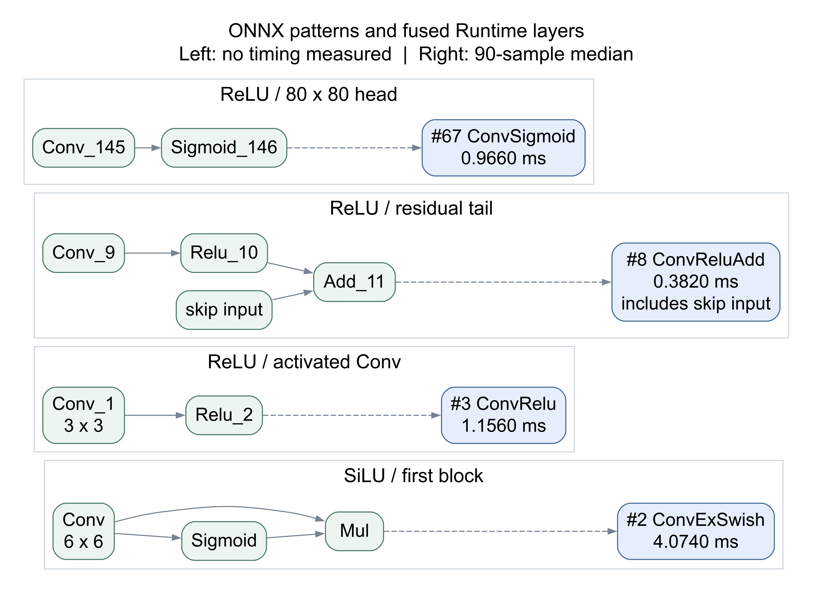
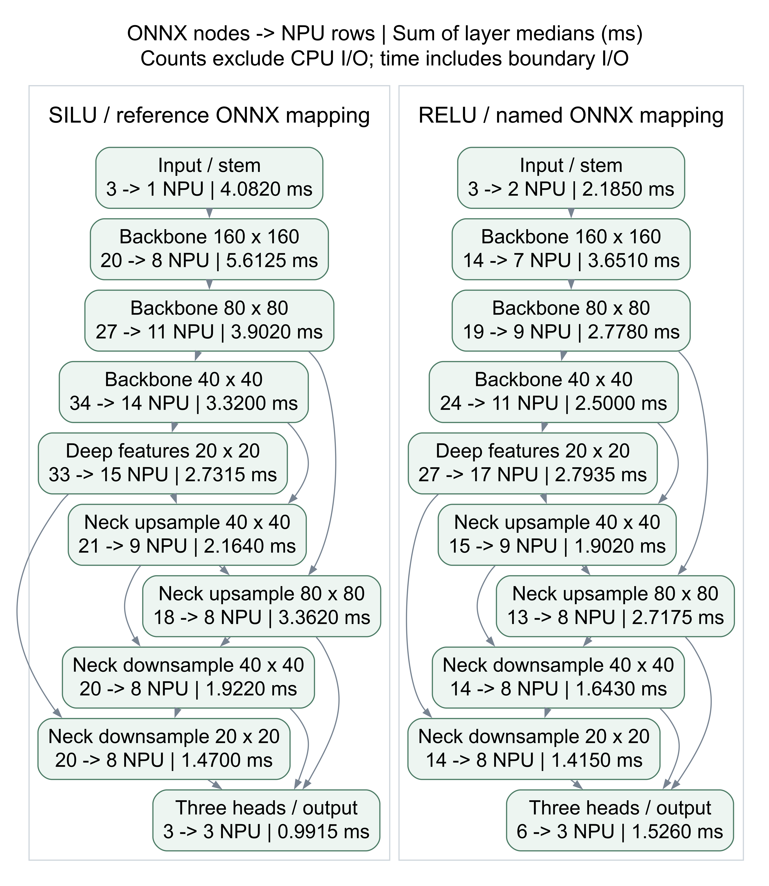
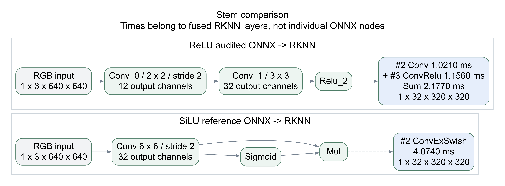
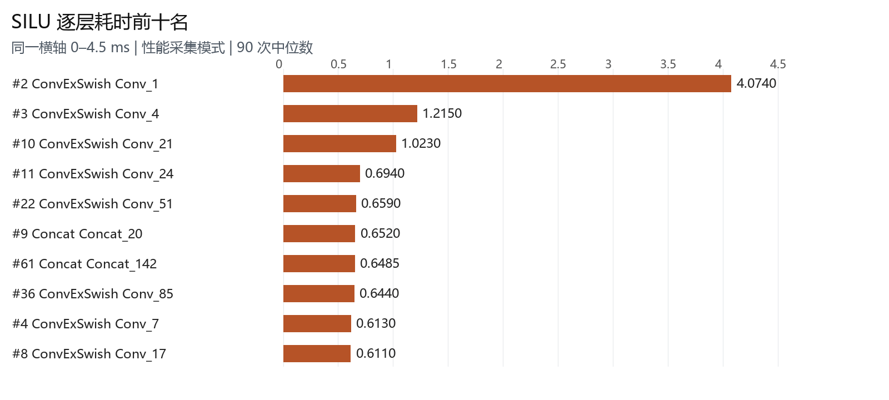
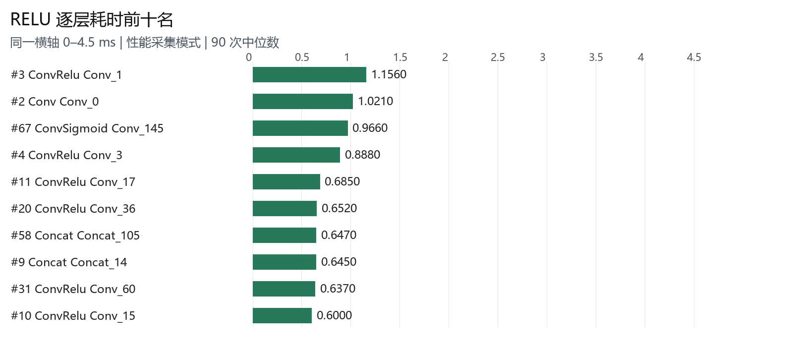

# YOLOv5 双模型算子融合与耗时分析

分析对象为 RK3588 上的 SiLU 与 ReLU 两份 YOLOv5s RKNN 部署模型。本文对照转换前 ONNX 的数学计算图与转换后 Runtime 暴露的融合执行层，说明热点在哪里、哪些差异与更快的 ReLU 版本相伴，以及现有证据还不能解释什么。

两版都已发生算子融合。SiLU 版出现 57 个 ConvExSwish；ReLU 版出现 50 个 ConvRelu、7 个 ConvReluAdd 和 3 个 ConvSigmoid。本次性能采集模式下，SDK 算子总时间中位数由 30.298 ms 降至 23.377 ms，降低 22.84%。这能证明两份部署版本存在性能差异，不能单独证明全部差异由激活替换造成。

| 指标 | SiLU | ReLU |
| --- | --- | --- |
| NPU 执行层 / CPU 边界层 | 85 / 4 | 82 / 4 |
| SDK 算子总时间中位数 | 30.298 ms | 23.377 ms |
| 最大单层热点 | #2 ConvExSwish<br>4.0740 ms / 13.78% | #3 ConvRelu<br>1.1560 ms / 5.00% |
| 首部计算块合计 不含 I/O | 4.0740 ms | 2.1770 ms |
| 结论适用范围 | 单 context 单 NPU 核 | 开启性能采集 同一输入 |

### 阅读顺序

先看实验条件与耗时口径，再看融合模式和全模型分区图，接着沿首部、残差块、检测头分析差异，最后查看热点表与归因边界。附录列出全部 175 行执行层耗时；完整 ONNX 图和融合图可放大查看。

报告整理日期为 2026-10-25，板端实测记录采集于 2026-10-23。本次整理未重新跑板。原始板端时钟存在偏差，归档保留其时间戳，日期以客户端实验记录为准。

## 1 实验条件与数据身份

| 条件 | 本次配置 |
| --- | --- |
| 硬件和系统 | Orange Pi 5 Pro / RK3588S<br>Linux 5.10.160 rockchip rk3588 |
| 软件 | RKNN Runtime 1.5.3b6，driver 0.9.6<br>不能与 Runtime 2.3.2 的历史测试直接混算 |
| 执行配置 | 1 context，core_mask=1 即 NPU core 0，batch=1 |
| 输入 | 相同 person.jpg，BGR 转 RGB，直接 resize 640×640，UINT8 |
| 采集 | RKNN_FLAG_COLLECT_PERF_MASK；每模型 3 轮<br>每轮预热 30 次，再采样 30 次，正式样本合计 90 次 |
| 运行顺序 | SiLU → ReLU → ReLU → SiLU → SiLU → ReLU |
| 频率与温度 | 不改 governor，未锁频；进程边界快照 NPU 1000 MHz、DDR 534 MHz，温度约 33–36℃ |
| 不包含 | 摄像头、RGA、线程池、CPU 检测解码/NMS、MPP、RTMP |

快照相同不等于全程频率恒定。该实验用于定位融合执行层热点，不是最终普通模式延迟、9 线程吞吐或 6 线程摄像头全链路验收。

### 模型校验和

SiLU：model/yolov5s.rknn，9,781,761 字节。

```text
9619248441d1b2008b55b1f74ef720159f558df8b945d01400a1c12ea192b90d
```

ReLU：model/yolov5s_relu_INT8_Normal.rknn，8,383,159 字节。

```text
6dc67c3c5fd1e18e6e80d24ab6c91606c22c80b818790f3c2089c96c6b56535b
```

精确命令、输入图与 Runtime 库校验和、各轮频率快照均保存在归档 metadata.json 中。

## 2 四种耗时口径

逐层报告中多个数字都可能被叫作“模型耗时”，但它们的计时范围不同。下面四行来自同一批采样，必须保留字段名称与统计方式，不能拿其中一行替换另一行。

| 计时指标 | SiLU ms | ReLU ms |
| --- | --- | --- |
| 每次 SDK Total Operator Elapsed Time<br>对 90 次总值取中位数 | 30.2980 | 23.3770 |
| 每层先取 90 次中位数，再按层相加<br>用于本文占比、区域汇总和类型汇总 | 29.5575 | 23.1110 |
| RKNN_QUERY_PERF_RUN.run_duration<br>90 次中位数 | 34.6390 | 27.5620 |
| 墙钟 rknn_run + rknn_outputs_get<br>不含 inputs_set，90 次中位数 | 37.2655 | 30.1370 |

### 为什么总时间与逐层相加不相等

中位数不是线性运算。先把某次全部层时间加起来，再对 90 个总值取中位数，与先对各层取中位数再相加，通常不相等；SDK 总计字段也有自己的汇总范围。因此不能仅凭两列差额推算 CPU 调度或内存拷贝耗时。

本文热点占比 = 该层 90 次中位耗时 ÷ 所有层中位耗时之和。例如 SiLU 首层 4.0740 ÷ 29.5575 ≈ 13.78%。这是耗时构成，不是 NPU 利用率。P95 表示该层 90 次样本的第 95 百分位，完整聚合规则见构建脚本。

### 如何解释性能改善

SDK 总时间降低 = (30.298 − 23.377) ÷ 30.298 ≈ 22.84%；同口径速度比约为 1.296 倍。单次推理延迟、多线程吞吐与端到端视频 FPS 是不同指标，不能互换。

历史 45 ms → 18 ms、约 2.5 倍的表述必须由它自己对应的模型、Runtime、计时范围、采样脚本和原始数据支撑。本文的性能采集实验既不验证也不直接否定那组历史数字，不能将两者拼成一组 A/B 结果。

## 3 从 ONNX 数学图到融合执行层

转换前的 ONNX 表达计算关系；转换后的 RKNN 由工具链生成适合设备执行的任务。Runtime 逐层报告提供融合类型和计时，但不是完整的硬件指令反汇编。本文融合图的节点名称与耗时为实测值，箭头通过 ONNX 依赖和融合成员收缩重建，不是 SDK 直接导出的内部边。



SiLU 的定义是 SiLU(z)=z×sigmoid(z)。ONNX 的 Sigmoid 和 Mul 合起来实现 SiLU，并不是“Sigmoid、Mul 再加一个 SiLU”。ConvExSwish 表示卷积和该激活融合执行；ReLU 为 max(0,z)，在当前模型中与卷积形成 ConvRelu。

本次拓扑中 ConvReluAdd 对应 Conv → ReLU → Add，并保留残差输入；不能只凭名字猜测所有模型的计算顺序。检测头的 ConvSigmoid 与主干 SiLU 不是同一回事。融合行的时间属于整个卷积、激活和可能的 Add，不能拆出“SiLU 单独耗时 4.074 ms”。

融合可减少独立执行层与部分中间数据交接的机会，但单个融合层仍可能拆成多项硬件任务。当前报告不能证明某块张量一定未写回 DDR，也不能把一个融合节点等同为一条硬件指令。两份所选 ONNX 范围均无 BatchNormalization，因此不能用本次报告证明 RKNN 在哪个阶段做了 Conv-BN 融合。

## 4 全模型结构与图的来源



SiLU 使用参考 ONNX：原图 364 节点，截取三路原始检测头之前、与执行层匹配的 199 个计算节点，映射为 85 个 NPU 层。不能把 364 → 85 全部说成融合收益，因为输出边界和解码范围已经不同。

ReLU 使用 149 节点 ONNX 审计快照，映射为 82 个 NPU 层；已将两个 Resize 辅助 Constant 转为 initializer，原 151 节点中的数据计算未因此减少。两图再分别加 4 个 CPU I/O 边界层，得到 89 / 86 行。

## 5 首部热点与结构差异



| 首部比较 不含 I/O | SiLU | ReLU |
| --- | --- | --- |
| 卷积结构 | 6×6，3→32 通道，stride 2 | 2×2，3→12 通道，stride 2<br>再 3×3，12→32 通道 |
| 最终输出 | 1×32×320×320 | 1×32×320×320 |
| 执行层耗时 | #2 ConvExSwish<br>4.0740 ms | #2 Conv 1.0210 ms<br>#3 ConvRelu 1.1560 ms |
| 首部计算块合计 | 4.0740 ms | 2.1770 ms |

SiLU 最大热点集中在首部；ReLU 首部两层合计少 1.8970 ms。按“各层中位数之和”的口径，总差为 29.5575 − 23.1110 = 6.4465 ms，首部差额约占这个账面差值的 29.43%。这是区域拆账，不是仅替换激活的因果贡献率。

两份图中的 Conv_1 名字相似，却不是同一个计算：一份是 6×6，另一份是 3×3。按同名节点逐一相减会错误归因；至少要核对输入/输出、卷积核、通道和分支位置。

首部张量空间分辨率大，数据通路和任务切分值得优先检查。SiLU 该行报告含 22 个 task、1 个 LUT，ReLU 两行共 21 个 task、0 个 LUT；这些只是报告字段，不能据此反推出 LUT 的独立耗时或实际 DDR 传输量。

## 6 残差上采样与检测头

| 路径 | SiLU | ReLU |
| --- | --- | --- |
| 主干激活融合 | 57 ConvExSwish | 50 ConvRelu + 7 ConvReluAdd |
| 残差加法 | 7 个独立 Add<br>合计 1.4040 ms | 7 个 Add 合入 ConvReluAdd<br>整组融合层合计 2.1770 ms |
| 上采样执行层 | 2 ConvTranspose<br>合计 0.4635 ms | 2 Resize<br>合计 0.3280 ms |
| 池化执行层 | 3 MaxPool / 0.2260 ms | 6 MaxPool / 0.4475 ms |
| 检测头卷积 | 3 Conv / 0.8565 ms<br>输出 raw logits | 3 ConvSigmoid / 1.3960 ms<br>输出已执行 Sigmoid |

### 残差融合不能按 Add 行直接计算收益

以第一个残差末端为例，SiLU 的 #6 ConvExSwish=0.5280 ms，加 #7 Add=0.4410 ms，合计 0.9690 ms；ReLU 的 #8 ConvReluAdd=0.3820 ms。但这些来自不同部署模型，不能说工具链单独融合 Add 就节省了 0.5870 ms。需要同图、同权重和相同量化条件下仅切换融合策略才能这样归因。

### 上采样名称变化与检测头语义

SiLU 的 Resize_119_2deconv 和 Resize_141_2deconv 被编译为 ConvTranspose，属于上采样的执行实现，不据此认定训练网络额外学了反卷积权重。ReLU 报告保留 Resize；两者数据不能直接推广为所有 RKNN 版本的策略。

ReLU 的 80×80 检测头 #67 ConvSigmoid=0.9660 ms，而 SiLU 对应 #68 Conv=0.5340 ms。ReLU 该行包含 Sigmoid，SiLU 图外的解码需要补这一步；当前性能采集不含 CPU 解码。比较检测头公平延迟时，必须把两份输出都走到相同的概率/解码边界，避免重复 Sigmoid 或漏做。

当前两版的 4 个 CPU 行均为 InputOperator / OutputOperator 边界，不是中间卷积或 SiLU 不支持、回退 CPU 的证据。

## 7 SiLU 耗时热点



| ID | 融合类型与源名 | 中位 ms | P95 ms | 占比 |
| --- | --- | --- | --- | --- |
| #2 | ConvExSwish / Conv_1 | 4.0740 | 4.3580 | 13.78% |
| #3 | ConvExSwish / Conv_4 | 1.2150 | 1.3400 | 4.11% |
| #10 | ConvExSwish / Conv_21 | 1.0230 | 1.1250 | 3.46% |
| #11 | ConvExSwish / Conv_24 | 0.6940 | 0.7740 | 2.35% |
| #22 | ConvExSwish / Conv_51 | 0.6590 | 0.8180 | 2.23% |
| #9 | Concat / Concat_20 | 0.6520 | 0.7260 | 2.21% |
| #61 | Concat / Concat_142 | 0.6485 | 0.7180 | 2.19% |
| #36 | ConvExSwish / Conv_85 | 0.6440 | 0.8040 | 2.18% |
| #4 | ConvExSwish / Conv_7 | 0.6130 | 0.6800 | 2.07% |
| #8 | ConvExSwish / Conv_17 | 0.6110 | 0.6780 | 2.07% |

SiLU 前十层合计占 36.65%，首层独占 13.78%，是最明确的单层热点。57 个 ConvExSwish 合计 22.8465 ms、占 77.30%，但其中包含卷积，不能把 77.30% 叫作激活函数开销。高分辨率卷积、残差 Add 与两处较大的 Concat 值得优先分析。

## 8 ReLU 耗时热点



| ID | 融合类型与源名 | 中位 ms | P95 ms | 占比 |
| --- | --- | --- | --- | --- |
| #3 | ConvRelu / Conv_1 | 1.1560 | 1.1610 | 5.00% |
| #2 | Conv / Conv_0 | 1.0210 | 1.0330 | 4.42% |
| #67 | ConvSigmoid / Conv_145 | 0.9660 | 1.0220 | 4.18% |
| #4 | ConvRelu / Conv_3 | 0.8880 | 0.8940 | 3.84% |
| #11 | ConvRelu / Conv_17 | 0.6850 | 0.6940 | 2.96% |
| #20 | ConvRelu / Conv_36 | 0.6520 | 0.6540 | 2.82% |
| #58 | Concat / Concat_105 | 0.6470 | 0.7010 | 2.80% |
| #9 | Concat / Concat_14 | 0.6450 | 0.6540 | 2.79% |
| #31 | ConvRelu / Conv_60 | 0.6370 | 0.6440 | 2.76% |
| #10 | ConvRelu / Conv_15 | 0.6000 | 0.6060 | 2.60% |

ReLU 前十层合计占 34.17%，首部两层分别占 5.00% 和 4.42%，没有 SiLU 那样突出的单层。首部、80×80 检测头和高分辨率特征融合分摊热点。ConvSigmoid 的存在说明 ReLU 主干并未消除检测头所需的概率变换。

## 9 类型汇总与瓶颈判断

| 执行类型 | SiLU 数量 / ms / 占比 | ReLU 数量 / ms / 占比 |
| --- | --- | --- |
| ConvExSwish | 57 / 22.8465 / 77.30% | — |
| Concat | 13 / 3.6180 / 12.24% | 13 / 3.6015 / 15.58% |
| Add | 7 / 1.4040 / 4.75% | — |
| Conv | 3 / 0.8565 / 2.90% | 1 / 1.0210 / 4.42% |
| ConvTranspose | 2 / 0.4635 / 1.57% | — |
| MaxPool | 3 / 0.2260 / 0.76% | 6 / 0.4475 / 1.94% |
| OutputOperator | 3 / 0.1350 / 0.46% | 3 / 0.1300 / 0.56% |
| InputOperator | 1 / 0.0080 / 0.03% | 1 / 0.0080 / 0.03% |
| ConvRelu | — | 50 / 14.0020 / 60.59% |
| ConvReluAdd | — | 7 / 2.1770 / 9.42% |
| ConvSigmoid | — | 3 / 1.3960 / 6.04% |
| Resize | — | 2 / 0.3280 / 1.42% |

表中按类型合并 INT8/UINT8，时间为各层中位数之和，分母分别为 29.5575 / 23.1110 ms。CPU I/O 同样计入分母。节点数变少并不保证硬件 task 变少：报告 task 总数为 207 → 224，因此不能以 89 → 86 行直接解释加速。

### Concat 的占比为何上升

两版 13 个 Concat 的绝对合计几乎相同：3.6180 → 3.6015 ms；ReLU 总耗时下降，使其占比由 12.24% 上升到 15.58%。这是剩余成本变得更显眼，并不是 Concat 变慢。拼接具有明显的数据搬运属性，但当前没有独立 DDR 带宽/事务测量，不能写成“已证实 DDR 带宽打满”。

卷积融合组的高占比证明优化优先级高，不足以区分计算受限和访存受限。MAC 使用率、DDR/NPU cycles、task 和 LUT 字段能提供线索，仍需结合形状、受控实验与硬件计数器。不要把 SDK 报告估算字段当作独立硬件带宽实测。

## 10 为什么 ReLU 版本更快

目前能确认的是：这份 ReLU 部署版本在相同输入和本次运行环境中更快。伴随差异包括更轻的激活数学形式、7 处残差融合，以及首部、池化、上采样和检测头实现差异。它们共同影响任务组织与数据通路，不能只用“ReLU 支持、SiLU 不支持”解释。

| 形状匹配候选 不代表同权重 | SiLU ms | ReLU ms | 差值 ms |
| --- | --- | --- | --- |
| #3 Conv_4<br>→ #4 Conv_3 | 1.2150 | 0.8880 | 0.3270 |
| #5 Conv_10<br>→ #7 Conv_7 | 0.5295 | 0.3140 | 0.2155 |
| #10 Conv_21<br>→ #10 Conv_15 | 1.0230 | 0.6000 | 0.4230 |

上述候选的输入、权重维度和输出形状匹配，SiLU 融合层更慢，且报告 LUT 为 1 → 0；这与更轻的激活路径一致。但权重、校准参数和编译策略没有全部受控，不能据此精确分摊激活收益。部分匹配项的 DDR/NPU cycles 字段相同，时间却不同，更不能简单归因为“DDR 访问减少”。

### 要把推测升级为因果结论

应在 Ubuntu 固定代码提交、模型宽深度、首部、检测头、导出边界和输入尺寸，仅改激活配置并训练/微调得到可用模型；使用同一校准图、量化配置和工具链构建 RKNN，再在板端固定 Runtime、核心和计时范围 A/B。可追加同图的未量化与 INT8 对照，帮助区分激活与量化/编译影响。激活不同仍会改变网络功能，精度必须独立验收。

### 如何决定先优化哪一层

先按稳定耗时与占比排序，再看可改变的计算量/数据量和精度风险。假设只把占总时间约 13.78% 的首层加速一倍，在其他成本不变、串行近似下，总时间约降低 6.89%，总速度约提升到 1.074 倍，而不是全模型提升一倍。

若继续研究，优先对齐首部结构和检测头语义，再检查高分辨率卷积与 Concat；512 输入属于模型规模优化，不是无损图简化。即使 NPU 延迟下降，30 FPS 摄像头限制下也不一定提高全链路 FPS，应同时看 CPU、排队延迟、内存与稳定性。

## 11 图源验证边界与复现入口

### 图源可信度

ReLU 图按 Runtime 源名匹配 ONNX 节点，将 57 个 ReLU、7 个 Add、3 个输出 Sigmoid 合入卷积，82 个 NPU 层全部完成输出形状核对。SiLU 使用另一份参考 ONNX 结构映射，已核对 60 个卷积权重形状、各算子数量、全部执行层覆盖和依赖顺序；85 个计算层中 81 个输出形状完全确定，4 个仍含未知维度。

SiLU 的原始 RKNN 构建源与权重同一性尚未证明。因此图用于解释与逐层报告一致的网络结构，不是旧 RKNN 的精确反编译。完整 ONNX 图只展示对应执行层的计算范围，静态权重和 initializer 不画成运算节点；融合前 ONNX 未采集单节点时间。

### 完整图与原始证据

[SiLU 转换前完整参考 ONNX 图 199 节点](activation_fusion_analysis/silu_before_full.svg)

[ReLU 转换前完整 ONNX 审计图 149 节点](activation_fusion_analysis/relu_before_full.svg)

[SiLU 转换后完整执行图 89 行含耗时](activation_perf_20261023/graphs/silu_all_layers.svg)

[ReLU 转换后完整执行图 86 行含耗时](activation_perf_20261023/graphs/relu_all_layers.svg)

[融合成员与重建依赖](activation_perf_20261023/graphs/fused_graphs.json)

[全部统计与形状匹配候选](activation_perf_20261023/comparison.json)

[原始逐层报告及运行元数据](activation_perf_20261023/raw/metadata.json)

完整图为长页 SVG，应在浏览器中放大查看；Word 正文使用总览和局部示例，避免把上百层压缩成不可读的小图。附录表可通过 Runtime ID 回查完整图；同一数字 ID 在两版中不一定对应同一计算。


## 附录 SiLU 全部执行层耗时

按 Runtime ID 排序，单位 ms；90 次中位数及 P95。InputOperator / OutputOperator 为 CPU 边界，其余行为 NPU。占比按各层中位数之和计算。

| ID | 类型 | 源节点名 | 中位 ms | P95 ms | 占比 |
| --- | --- | --- | --- | --- | --- |
| 1 | InputOperator | images | 0.0080 | 0.0170 | 0.03% |
| 2 | ConvExSwish | Conv_1 | 4.0740 | 4.3580 | 13.78% |
| 3 | ConvExSwish | Conv_4 | 1.2150 | 1.3400 | 4.11% |
| 4 | ConvExSwish | Conv_7 | 0.6130 | 0.6800 | 2.07% |
| 5 | ConvExSwish | Conv_10 | 0.5295 | 0.5950 | 1.79% |
| 6 | ConvExSwish | Conv_13 | 0.5280 | 0.5950 | 1.79% |
| 7 | Add | Add_16 | 0.4410 | 0.5250 | 1.49% |
| 8 | ConvExSwish | Conv_17 | 0.6110 | 0.6780 | 2.07% |
| 9 | Concat | Concat_20 | 0.6520 | 0.7260 | 2.21% |
| 10 | ConvExSwish | Conv_21 | 1.0230 | 1.1250 | 3.46% |
| 11 | ConvExSwish | Conv_24 | 0.6940 | 0.7740 | 2.35% |
| 12 | ConvExSwish | Conv_27 | 0.3310 | 0.3950 | 1.12% |
| 13 | ConvExSwish | Conv_30 | 0.2840 | 0.3480 | 0.96% |
| 14 | ConvExSwish | Conv_33 | 0.3130 | 0.3760 | 1.06% |
| 15 | Add | Add_36 | 0.2360 | 0.3560 | 0.80% |
| 16 | ConvExSwish | Conv_37 | 0.2830 | 0.3470 | 0.96% |
| 17 | ConvExSwish | Conv_40 | 0.3130 | 0.3760 | 1.06% |
| 18 | Add | Add_43 | 0.2370 | 0.3020 | 0.80% |
| 19 | ConvExSwish | Conv_44 | 0.3330 | 0.3990 | 1.13% |
| 20 | Concat | Concat_47 | 0.3410 | 0.4050 | 1.15% |
| 21 | ConvExSwish | Conv_48 | 0.5370 | 0.6980 | 1.82% |
| 22 | ConvExSwish | Conv_51 | 0.6590 | 0.8180 | 2.23% |
| 23 | ConvExSwish | Conv_54 | 0.1910 | 0.3520 | 0.65% |
| 24 | ConvExSwish | Conv_57 | 0.1640 | 0.2320 | 0.55% |
| 25 | ConvExSwish | Conv_60 | 0.3000 | 0.3640 | 1.01% |
| 26 | Add | Add_63 | 0.1350 | 0.2020 | 0.46% |
| 27 | ConvExSwish | Conv_64 | 0.1630 | 0.2290 | 0.55% |
| 28 | ConvExSwish | Conv_67 | 0.2980 | 0.3630 | 1.01% |
| 29 | Add | Add_70 | 0.1350 | 0.2260 | 0.46% |
| 30 | ConvExSwish | Conv_71 | 0.1620 | 0.2330 | 0.55% |
| 31 | ConvExSwish | Conv_74 | 0.2990 | 0.3610 | 1.01% |
| 32 | Add | Add_77 | 0.1350 | 0.2020 | 0.46% |
| 33 | ConvExSwish | Conv_78 | 0.1910 | 0.2590 | 0.65% |
| 34 | Concat | Concat_81 | 0.1880 | 0.2510 | 0.64% |
| 35 | ConvExSwish | Conv_82 | 0.3000 | 0.3890 | 1.01% |
| 36 | ConvExSwish | Conv_85 | 0.6440 | 0.8040 | 2.18% |
| 37 | ConvExSwish | Conv_88 | 0.1300 | 0.2530 | 0.44% |
| 38 | ConvExSwish | Conv_91 | 0.1110 | 0.2270 | 0.38% |
| 39 | ConvExSwish | Conv_94 | 0.2980 | 0.4200 | 1.01% |
| 40 | Add | Add_97 | 0.0850 | 0.1770 | 0.29% |
| 41 | ConvExSwish | Conv_98 | 0.1300 | 0.1950 | 0.44% |
| 42 | Concat | Concat_101 | 0.1125 | 0.1770 | 0.38% |
| 43 | ConvExSwish | Conv_102 | 0.1930 | 0.2860 | 0.65% |
| 44 | ConvExSwish | Conv_105 | 0.1300 | 0.1930 | 0.44% |
| 45 | MaxPool | MaxPool_108 | 0.0760 | 0.1400 | 0.26% |
| 46 | MaxPool | MaxPool_109 | 0.0750 | 0.1390 | 0.25% |
| 47 | MaxPool | MaxPool_110 | 0.0750 | 0.1410 | 0.25% |
| 48 | Concat | Concat_111 | 0.1900 | 0.2530 | 0.64% |
| 49 | ConvExSwish | Conv_112 | 0.3510 | 0.4910 | 1.19% |
| 50 | ConvExSwish | Conv_115 | 0.1310 | 0.2100 | 0.44% |
| 51 | ConvTranspose | Resize_119_2deconv | 0.1520 | 0.2140 | 0.51% |
| 52 | Concat | Concat_120 | 0.3450 | 0.4130 | 1.17% |
| 53 | ConvExSwish | Conv_121 | 0.2610 | 0.3280 | 0.88% |
| 54 | ConvExSwish | Conv_124 | 0.1630 | 0.2930 | 0.55% |
| 55 | ConvExSwish | Conv_127 | 0.3000 | 0.3670 | 1.01% |
| 56 | ConvExSwish | Conv_130 | 0.2610 | 0.3250 | 0.88% |
| 57 | Concat | Concat_133 | 0.1900 | 0.2520 | 0.64% |
| 58 | ConvExSwish | Conv_134 | 0.3000 | 0.4010 | 1.01% |
| 59 | ConvExSwish | Conv_137 | 0.1920 | 0.2550 | 0.65% |
| 60 | ConvTranspose | Resize_141_2deconv | 0.3115 | 0.3870 | 1.05% |
| 61 | Concat | Concat_142 | 0.6485 | 0.7180 | 2.19% |
| 62 | ConvExSwish | Conv_143 | 0.4580 | 0.5240 | 1.55% |
| 63 | ConvExSwish | Conv_146 | 0.2860 | 0.3500 | 0.97% |
| 64 | ConvExSwish | Conv_149 | 0.3150 | 0.4000 | 1.07% |
| 65 | ConvExSwish | Conv_152 | 0.4565 | 0.5400 | 1.54% |
| 66 | Concat | Concat_155 | 0.3450 | 0.4740 | 1.17% |
| 67 | ConvExSwish | Conv_156 | 0.5415 | 0.6200 | 1.83% |
| 68 | Conv | Conv_199 | 0.5340 | 0.6010 | 1.81% |
| 69 | OutputOperator | output0 | 0.0960 | 0.2650 | 0.32% |
| 70 | ConvExSwish | Conv_159 | 0.3970 | 0.4880 | 1.34% |
| 71 | Concat | Concat_162 | 0.1900 | 0.2530 | 0.64% |
| 72 | ConvExSwish | Conv_163 | 0.1920 | 0.2750 | 0.65% |
| 73 | ConvExSwish | Conv_166 | 0.1630 | 0.2250 | 0.55% |
| 74 | ConvExSwish | Conv_169 | 0.2990 | 0.3830 | 1.01% |
| 75 | ConvExSwish | Conv_172 | 0.1920 | 0.2560 | 0.65% |
| 76 | Concat | Concat_175 | 0.1890 | 0.2530 | 0.64% |
| 77 | ConvExSwish | Conv_176 | 0.3000 | 0.3650 | 1.01% |
| 78 | Conv | Conv_200 | 0.1970 | 0.2600 | 0.67% |
| 79 | OutputOperator | 327 | 0.0260 | 0.0710 | 0.09% |
| 80 | ConvExSwish | Conv_179 | 0.3780 | 0.4430 | 1.28% |
| 81 | Concat | Concat_182 | 0.1140 | 0.1780 | 0.39% |
| 82 | ConvExSwish | Conv_183 | 0.1300 | 0.1920 | 0.44% |
| 83 | ConvExSwish | Conv_186 | 0.1110 | 0.1750 | 0.38% |
| 84 | ConvExSwish | Conv_189 | 0.3000 | 0.3600 | 1.01% |
| 85 | ConvExSwish | Conv_192 | 0.1300 | 0.1920 | 0.44% |
| 86 | Concat | Concat_195 | 0.1130 | 0.2050 | 0.38% |
| 87 | ConvExSwish | Conv_196 | 0.1940 | 0.2690 | 0.66% |
| 88 | Conv | Conv_201 | 0.1255 | 0.1870 | 0.42% |
| 89 | OutputOperator | 328 | 0.0130 | 0.0330 | 0.04% |

## 附录 ReLU 全部执行层耗时

按 Runtime ID 排序，单位 ms；90 次中位数及 P95。InputOperator / OutputOperator 为 CPU 边界，其余行为 NPU。占比按各层中位数之和计算。

| ID | 类型 | 源节点名 | 中位 ms | P95 ms | 占比 |
| --- | --- | --- | --- | --- | --- |
| 1 | InputOperator | images | 0.0080 | 0.0100 | 0.03% |
| 2 | Conv | Conv_0 | 1.0210 | 1.0330 | 4.42% |
| 3 | ConvRelu | Conv_1 | 1.1560 | 1.1610 | 5.00% |
| 4 | ConvRelu | Conv_3 | 0.8880 | 0.8940 | 3.84% |
| 5 | ConvRelu | Conv_5 | 0.4110 | 0.4130 | 1.78% |
| 6 | ConvRelu | Conv_12 | 0.4110 | 0.4130 | 1.78% |
| 7 | ConvRelu | Conv_7 | 0.3140 | 0.3160 | 1.36% |
| 8 | ConvReluAdd | Conv_9 | 0.3820 | 0.3850 | 1.65% |
| 9 | Concat | Concat_14 | 0.6450 | 0.6540 | 2.79% |
| 10 | ConvRelu | Conv_15 | 0.6000 | 0.6060 | 2.60% |
| 11 | ConvRelu | Conv_17 | 0.6850 | 0.6940 | 2.96% |
| 12 | ConvRelu | Conv_19 | 0.2280 | 0.2330 | 0.99% |
| 13 | ConvRelu | Conv_31 | 0.2290 | 0.2340 | 0.99% |
| 14 | ConvRelu | Conv_21 | 0.1770 | 0.1820 | 0.77% |
| 15 | ConvReluAdd | Conv_23 | 0.3110 | 0.3140 | 1.35% |
| 16 | ConvRelu | Conv_26 | 0.1750 | 0.1860 | 0.76% |
| 17 | ConvReluAdd | Conv_28 | 0.3110 | 0.3150 | 1.35% |
| 18 | Concat | Concat_33 | 0.3380 | 0.3400 | 1.46% |
| 19 | ConvRelu | Conv_34 | 0.3240 | 0.3310 | 1.40% |
| 20 | ConvRelu | Conv_36 | 0.6520 | 0.6540 | 2.82% |
| 21 | ConvRelu | Conv_38 | 0.1415 | 0.1430 | 0.61% |
| 22 | ConvRelu | Conv_55 | 0.1415 | 0.1430 | 0.61% |
| 23 | ConvRelu | Conv_40 | 0.0990 | 0.1010 | 0.43% |
| 24 | ConvReluAdd | Conv_42 | 0.2940 | 0.2950 | 1.27% |
| 25 | ConvRelu | Conv_45 | 0.0990 | 0.1010 | 0.43% |
| 26 | ConvReluAdd | Conv_47 | 0.2940 | 0.2950 | 1.27% |
| 27 | ConvRelu | Conv_50 | 0.0990 | 0.1000 | 0.43% |
| 28 | ConvReluAdd | Conv_52 | 0.2940 | 0.2970 | 1.27% |
| 29 | Concat | Concat_57 | 0.1900 | 0.1920 | 0.82% |
| 30 | ConvRelu | Conv_58 | 0.1960 | 0.1980 | 0.85% |
| 31 | ConvRelu | Conv_60 | 0.6370 | 0.6440 | 2.76% |
| 32 | ConvRelu | Conv_62 | 0.1260 | 0.1280 | 0.55% |
| 33 | ConvRelu | Conv_69 | 0.1260 | 0.1270 | 0.55% |
| 34 | ConvRelu | Conv_64 | 0.0820 | 0.0830 | 0.35% |
| 35 | ConvReluAdd | Conv_66 | 0.2910 | 0.3030 | 1.26% |
| 36 | Concat | Concat_71 | 0.1120 | 0.1230 | 0.48% |
| 37 | ConvRelu | Conv_72 | 0.1870 | 0.2420 | 0.81% |
| 38 | ConvRelu | Conv_74 | 0.1260 | 0.1470 | 0.55% |
| 39 | MaxPool | MaxPool_76 | 0.0750 | 0.0780 | 0.32% |
| 40 | MaxPool | MaxPool_77 | 0.0740 | 0.0770 | 0.32% |
| 41 | MaxPool | MaxPool_78 | 0.0745 | 0.0780 | 0.32% |
| 42 | MaxPool | MaxPool_79 | 0.0750 | 0.0770 | 0.32% |
| 43 | MaxPool | MaxPool_80 | 0.0750 | 0.0770 | 0.32% |
| 44 | MaxPool | MaxPool_81 | 0.0740 | 0.0770 | 0.32% |
| 45 | Concat | Concat_82 | 0.1890 | 0.1910 | 0.82% |
| 46 | ConvRelu | Conv_83 | 0.3440 | 0.3470 | 1.49% |
| 47 | ConvRelu | Conv_85 | 0.1260 | 0.1280 | 0.55% |
| 48 | Resize | Resize_88 | 0.1270 | 0.1390 | 0.55% |
| 49 | Concat | Concat_89 | 0.3450 | 0.3960 | 1.49% |
| 50 | ConvRelu | Conv_90 | 0.2550 | 0.2640 | 1.10% |
| 51 | ConvRelu | Conv_96 | 0.2540 | 0.3090 | 1.10% |
| 52 | ConvRelu | Conv_92 | 0.1010 | 0.1560 | 0.44% |
| 53 | ConvRelu | Conv_94 | 0.2940 | 0.3490 | 1.27% |
| 54 | Concat | Concat_98 | 0.1900 | 0.2450 | 0.82% |
| 55 | ConvRelu | Conv_99 | 0.1960 | 0.2500 | 0.85% |
| 56 | ConvRelu | Conv_101 | 0.1400 | 0.1420 | 0.61% |
| 57 | Resize | Resize_104 | 0.2010 | 0.2550 | 0.87% |
| 58 | Concat | Concat_105 | 0.6470 | 0.7010 | 2.80% |
| 59 | ConvRelu | Conv_106 | 0.3600 | 0.4140 | 1.56% |
| 60 | ConvRelu | Conv_112 | 0.3610 | 0.4160 | 1.56% |
| 61 | ConvRelu | Conv_108 | 0.1780 | 0.2330 | 0.77% |
| 62 | ConvRelu | Conv_110 | 0.3070 | 0.3630 | 1.33% |
| 63 | Concat | Concat_114 | 0.3405 | 0.3980 | 1.47% |
| 64 | ConvRelu | Conv_115 | 0.3230 | 0.3770 | 1.40% |
| 65 | ConvRelu | Conv_117 | 0.3870 | 0.4410 | 1.67% |
| 66 | Concat | Concat_119 | 0.1910 | 0.2460 | 0.83% |
| 67 | ConvSigmoid | Conv_145 | 0.9660 | 1.0220 | 4.18% |
| 68 | OutputOperator | output | 0.0930 | 0.1030 | 0.40% |
| 69 | ConvRelu | Conv_120 | 0.1440 | 0.1960 | 0.62% |
| 70 | ConvRelu | Conv_126 | 0.1420 | 0.1960 | 0.61% |
| 71 | ConvRelu | Conv_122 | 0.1000 | 0.1540 | 0.43% |
| 72 | ConvRelu | Conv_124 | 0.2950 | 0.3490 | 1.28% |
| 73 | Concat | Concat_128 | 0.1880 | 0.2430 | 0.81% |
| 74 | ConvRelu | Conv_129 | 0.1960 | 0.2510 | 0.85% |
| 75 | ConvRelu | Conv_131 | 0.3720 | 0.4270 | 1.61% |
| 76 | Concat | Concat_133 | 0.1130 | 0.1670 | 0.49% |
| 77 | ConvSigmoid | Conv_147 | 0.3000 | 0.3530 | 1.30% |
| 78 | OutputOperator | 283 | 0.0260 | 0.0280 | 0.11% |
| 79 | ConvRelu | Conv_134 | 0.1270 | 0.1790 | 0.55% |
| 80 | ConvRelu | Conv_140 | 0.1260 | 0.1790 | 0.55% |
| 81 | ConvRelu | Conv_136 | 0.0820 | 0.1350 | 0.35% |
| 82 | ConvRelu | Conv_138 | 0.2940 | 0.3470 | 1.27% |
| 83 | Concat | Concat_142 | 0.1130 | 0.1670 | 0.49% |
| 84 | ConvRelu | Conv_143 | 0.1880 | 0.2420 | 0.81% |
| 85 | ConvSigmoid | Conv_149 | 0.1300 | 0.1840 | 0.56% |
| 86 | OutputOperator | 285 | 0.0110 | 0.0130 | 0.05% |
